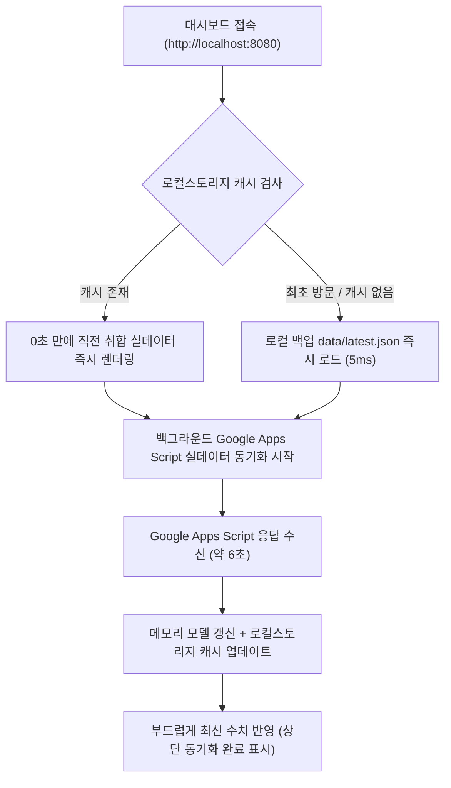

# its-ad-insight 데이터 연동 설정 및 상시 자동화 가이드

본 문서는 `its-ad-insight` 광고·견적 통합 대시보드의 **실제 데이터 연동 정보**와 **상시 무인 자동화(Zero-Touch) 아키텍처**를 기록한 문서입니다.  
대시보드 스크립트([js/main.js](file:///C:/0.Project/its-ad-insight/js/main.js)) 내부에 해당 정보가 기본값으로 고정되어 있으므로, **별도의 "연결 설정" 버튼을 누르지 않아도 모든 사용자와 브라우저에서 자동으로 즉시 연동**됩니다.

---

## 1. 상시 연동 핵심 접속 정보

| 항목 | 설정값 | 용도 및 비고 |
| :--- | :--- | :--- |
| **웹 앱 URL** | `https://script.google.com/macros/s/AKfycbzQS9yMlp9L_eRaH77QWLsY6GOY7L5hyRk1fkuaAHg8GvJmHHwhPRgr2zWldgbX5-cNcg/exec` | Google Apps Script 최신 배포 엔드포인트 |
| **웹 앱 비밀키 (Key)** | `2d3b0cc2b04a4873a835583968ca7a0b` | API 인증 파라미터 (`?key=...`) |
| **취합 구글 스프레드시트 ID** | `1mxrTeh7bo50RTz_2_UNyQxtQrljoEK4-xgPy9fr8nIg` | [광고비·전환·견적 취합 시트 바로가기](https://docs.google.com/spreadsheets/d/1mxrTeh7bo50RTz_2_UNyQxtQrljoEK4-xgPy9fr8nIg/edit) |
| **자동 동기화 주기** | 10분마다 백그라운드 자동 갱신 | 브라우저 열어둘 시 10분 간격 SWR 무중단 갱신 |

---

## 2. 상시 자동 연동 (Zero-Touch) 동작 원리

대시보드는 사용자의 추가 조작 없이 **0초 만에 화면이 로드되고 항상 최신 상태를 유지**하도록 3단계 캐싱·연동 체계를 갖추고 있습니다:

1. **스크립트 고정 기본값 (Fallback)**:
   - [js/main.js](file:///C:/0.Project/its-ad-insight/js/main.js)의 `DEFAULT_URL`과 `DEFAULT_KEY`에 위 연동 정보가 고정되어 있습니다.
   - `localStorage`나 `config.js`가 비어 있더라도 스크립트가 알아서 해당 주소로 통신합니다.
2. **0초 SWR(Stale-While-Revalidate) 로컬 캐싱**:
   - 한 번 받아온 실데이터는 브라우저 로컬 저장소에 안전하게 보존됩니다.
   - 새로고침이나 탭 이동 시 6초의 네트워크 지연 없이 **즉시 실데이터가 노출**되며, 백그라운드에서 최신 데이터를 받아와 화면을 업데이트합니다.
3. **네트워크 장애 대비 화면 유지**:
   - 구글 서버 지연이나 일시적 네트워크 끊김이 발생해도 화면을 빈 상태나 에러로 초기화하지 않고 **기존 실데이터 화면을 안전하게 유지**합니다.

---

## 3. 연동 데이터 현황

- **네이버 검색광고 (SA)**:
  - 2025년 1월 ~ 2026년 10월 월별 광고비 집행 내역 (960개 광고그룹 행)
  - 최근 30일 상위 검색 키워드: 2,517개
  - 집행 소재: 476개
- **ITKET 견적 접수 현황**:
  - 2021년 12월 ~ 2026년 10월 월별 접수 견적 (293개 월/카테고리 행)
  - 서버·워크스테이션·스토리지·PC·노트북 카테고리별 유입 및 CPA 집계
- **매체/캠페인 매핑**:
  - 90개 매체·캠페인·광고그룹 대 카테고리 자동 배분 매핑 규칙 적용

---

## 4. 접속 정보 변경 방법 (필요 시)

만약 향후 구글 스프레드시트의 Apps Script를 새로 배포하여 웹앱 URL이나 비밀키가 변경되는 경우:
1. **방법 1 (간편)**: 대시보드 우측 상단 톱니바퀴 아이콘을 클릭하여 새 URL과 비밀키를 입력하고 [저장 · 불러오기]를 누릅니다.
2. **방법 2 (영구 고정)**: [js/main.js](file:///C:/0.Project/its-ad-insight/js/main.js) 상단의 `DEFAULT_URL`과 `DEFAULT_KEY`를 새 값으로 수정합니다.
